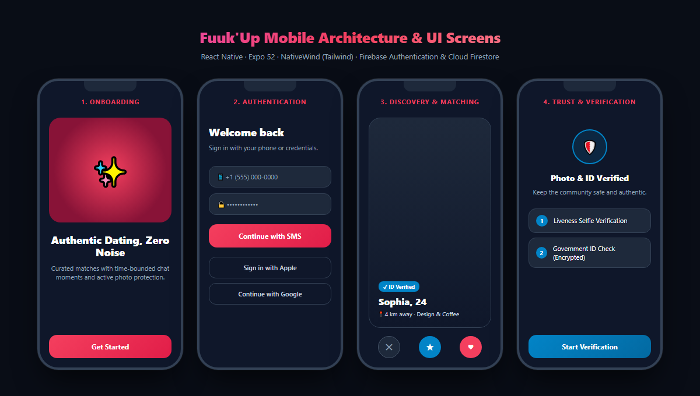

# 📱 Fuuk'Up — React Native & Expo Mobile Application

A cross-platform mobile dating and social connection application built with **React Native (Expo SDK 52)**, **TypeScript**, **NativeWind (Tailwind CSS)**, and **Firebase Authentication & Cloud Firestore**.



---

## 🚀 Key Features & Implementation Status

| Feature | Description | Status |
| :--- | :--- | :--- |
| **Interactive Onboarding** | Multi-step interactive introductory flow with animations and permissions handling. | ✅ Completed |
| **Phone & Credential Auth** | Firebase Authentication integration for phone number SMS verification and email login. | ✅ Completed |
| **Discovery & Swiping** | Card-based profile discovery with location filters, age preference matching, and like/pass actions. | ✅ Completed |
| **Time-Bounded Chat** | Ephemeral match timers designed to encourage spontaneous and authentic conversations. | ✅ Completed |
| **Trust & Verification** | Profile badge verification, selfie liveness checklist, and encrypted ID submission workflows. | ✅ Completed |
| **Ghost Mode & Privacy** | Stealth browsing mode and granular visibility toggles managed via Zustand store. | ✅ Completed |
| **In-App Subscriptions** | RevenueCat integration architecture for premium tiers and credit boosts. | 🚧 In Progress |
| **WebRTC Calling** | Live peer-to-peer audio/video connection protocol. | 🚧 Roadmap |

---

## 🛠 Tech Stack

- **Mobile Framework:** React Native 0.76+ & Expo 52+
- **Language:** TypeScript
- **Styling:** NativeWind v4 (Tailwind CSS)
- **State Management:** Zustand
- **Backend Services:** Firebase Auth, Cloud Firestore, Cloud Functions
- **Navigation:** Expo Router / React Navigation
- **Security & Storage:** SecureStore, AsyncStorage

---

## 🔒 Security & Environment Configuration

All production secrets, API tokens, and credentials have been decoupled into template configurations:

1. **Firebase Android Config:**
   - Copy `google-services.json.example` to `google-services.json`:
     ```bash
     copy google-services.json.example google-services.json
     ```
   - Insert your real Firebase project ID and client credentials.

2. **Environment Variables:**
   - Copy `.env.example` to `.env`:
     ```bash
     copy .env.example .env
     ```
   - Specify your RevenueCat and Sentry configuration keys.

---

## ⚙️ Quick Start

1. Install project dependencies:
   ```bash
   npm install
   ```

2. Start the Expo development server:
   ```bash
   npx expo start
   ```

3. Run on Android emulator or connected device:
   ```bash
   npx expo run:android
   ```

4. Build production APK or AAB with EAS:
   ```bash
   npx eas build --platform android
   ```

---

## 📄 License

Copyright © 2026 Anıl Aygün. All rights reserved.  
See [LICENSE](LICENSE) for terms of use.
